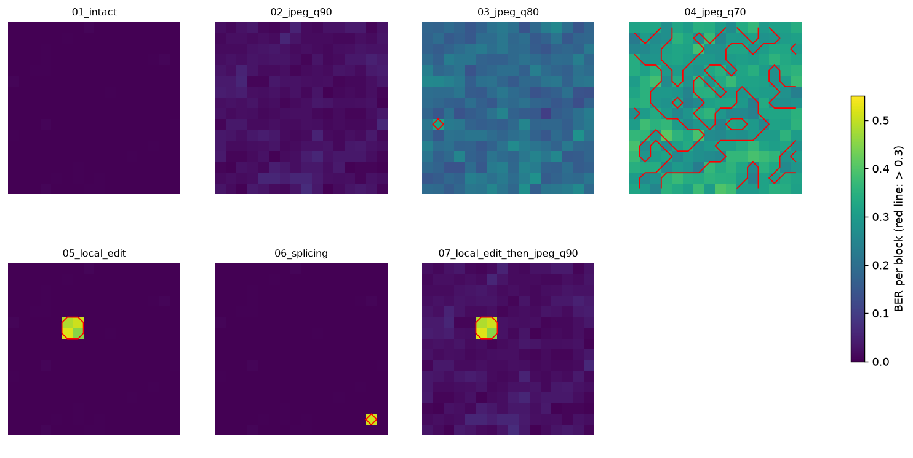

# Dual DWT watermark + ML-DSA-44: a demo of image provenance and tamper detection

A small but runnable implementation of this scheme: an image gets **two layers of DWT-based watermark**,
and its certificate is **signed with ML-DSA-44** (FIPS 204). It aims to answer two questions about an image
that has been recompressed (for example by a messaging app):

1. **Where did this image come from?** (robust ID + post-quantum signature)
2. **Was any part manipulated, and in which block?** (semi-fragile per-block fingerprint + BER)

> This is a research and teaching implementation, **not a security product**. The compression simulated
> here is plain JPEG, not a replica of WhatsApp's pipeline. See [Limitations](#limitations).



## Concept guide

Read in order. Each page has runnable code:

1. [DWT: splitting an image into coarse and fine](docs/01-dwt.md)
2. [BER: not "same or different?", but "how different?"](docs/02-ber.md)
3. [Verification without the original image (*blind*)](docs/03-blind-verification.md)

## Quick start

Requires Python 3.10+.

```bash
pip install -r requirements.txt

python demo.py              # runs every scenario and saves assets to outputs/
python -m pytest -q         # 7 tests
jupyter notebook notebooks/demo.ipynb   # interactive technical walkthrough
```

With your own image (PNG/JPEG, colour or grayscale):

```bash
python demo.py --input my_photo.png
```

`demo.py` writes to `outputs/` (not committed): the original and watermarked images, each scenario image with a
green/red overlay per block, `ber_maps_all_scenarios.png`, `results.json`, and `record.json` (the publisher's
record: certificates, signature, public key; never the private key).

### Full check of a received image (ID, signature, BER)

```bash
python verify_image.py outputs/02_jpeg_q90.png outputs/record.json   # compressed, intact  -> all pass
python verify_image.py outputs/05_local_edit.png outputs/record.json # edited              -> suspicious blocks listed
```

It runs three steps: (1) read the robust ID from the image and match it with the record, (2) verify the ML-DSA-44
signature over the record's certificates, (3) per-block BER on the image. The exit code is 0 only if all three pass.
The signature vouches for the **record**, not for the pixels: an image with no watermark at all still gets a valid
signature check (try `outputs/00_original.png`), but fails steps 1 and 3. Trust the public key only if its
fingerprint matches one you obtained from the publisher.

## Results on a synthetic image (512x512, 256 blocks)

Y-channel PSNR: 31.97 dB. Block BER threshold: 0.30. Example ID: 123456789.

| Scenario | Valid blocks | Invalid blocks | Mean BER | ID read |
|---|---|---|---|---|
| Intact | 100% | 0 | 0.000 | yes |
| JPEG q90 | 100% | 0 | 0.024 | yes |
| JPEG q80 | 99.6% | 1 | 0.192 | yes |
| JPEG q70 | 37.5% | 160 | 0.311 | yes |
| Local edit (2x2 blocks) | 98.4% | 4 | 0.008 | yes |
| Splicing (1 block) | 99.6% | 1 | 0.002 | yes |
| Local edit then JPEG q90 | 98.4% | 4 | 0.031 | yes |

At JPEG q70 the semi-fragile layer already raises false alarms on many blocks that are actually intact, while the
robust ID can still be read. That is why there are two layers. The numbers come from one synthetic image with a
fixed seed and **do not generalise** to other photos or channels.

## How it works

```
Publisher                                                   Verifier
---------                                                   --------
image --Y--> 32x32 blocks --Haar DWT--> LL, LH, HL, HH      received image (possibly recompressed)
                |                                              |
   (1) plant a 48-bit ID in LL  (QIM, robust)                  (a) extract the ID: soft voting across
   (2) fingerprint = parity(LL / Q_LL_HASH)                        all blocks + CRC -> ID / none
         XOR position_salt(row, col)                           (b) per block: read bits from HL,
   (3) embed 256 bits into 256 HL coefficients (QIM, Q_EMBED)      recompute the fingerprint from LL,
   (4) inverse DWT -> watermarked block                            BER = fraction of differing bits
                |                                              (c) BER <= 0.30 -> block valid
   block certificate = SHA-256(quantised LL)                       BER >  0.30 -> block suspicious
                |                                              (d) fetch certificates + signature
   root_hash = SHA-256(all certificates)                           from the server using the ID,
   signature = ML-DSA-44.sign(private key, root_hash)              check with the public key
```

**Why 32x32 blocks?** LL and HL of each block are 16x16 = 256 coefficients, equal to the fingerprint length, so
1 HL coefficient carries exactly 1 bit.

**Why BER and not a hash?** SHA-256 changes completely when a single pixel changes (the avalanche effect), so it
cannot tell "reasonably compressed" from "edited". A fingerprint from the quantised LL changes gradually, so the
difference can be measured with BER and given a threshold.

**Why a position salt?** The fingerprint is XORed with bits derived from the block coordinates. A valid block
copied to another position in the same image no longer matches its new position (anti-splicing).

**Why two layers?** Heavy compression destroys the semi-fragile layer (HL) first, while the short identifier in LL,
with voting across blocks and a CRC, survives longer. That ID points to the server that stores the full
certificates and signature.

**Why a signature?** The watermark algorithm is public, so anyone can produce an image with a watermark that looks
valid. An asymmetric signature proves **who the publisher is**. ML-DSA-44 is chosen because it is a NIST standard
(FIPS 204) designed to resist quantum computers. A signature is 2,420 bytes and a public key 1,312 bytes, too large
to embed in an image that will be compressed, so they are stored on a server and referenced through the ID.

**Colour images:** only the luminance (Y) channel of YCrCb is modified. Cr and Cb are untouched.

### Parameters (`wm/config.py`)

| Parameter | Value | Meaning |
|---|---|---|
| `BLOCK_SIZE` | 32 | block size (pixels) |
| `Q_EMBED` | 16 | embedding strength of the fingerprint into HL |
| `Q_LL_HASH` | 48 | LL quantisation coarseness for the fingerprint |
| `BER_THRESHOLD` | 0.30 | valid/invalid threshold per block |
| `Q_ID_LL`, `ID_DITHER` | 16, 4 | QIM step and lattice offset of the robust ID |

These values were calibrated for specific conditions. Changing `BLOCK_SIZE` or the image type means `Q_LL_HASH` and
the threshold must be recalibrated.

## Structure

```
wm/
  config.py        parameters
  dwt.py           Haar DWT, reconstruction, coefficient position layout
  fingerprint.py   per-block fingerprint, position salt, SHA-256 certificate, BER
  robust_id.py     32-bit ID + CRC-16, QIM in LL, extraction with voting
  embed.py         block-wise embedding on the Y channel
  verify.py        per-block BER, valid/invalid map
  signing.py       root hash + ML-DSA-44 signature
  imaging.py       synthetic image, JPEG, local edit, splicing, overlay
demo.py            end-to-end scenarios + saving assets and record.json
verify_image.py    full check of a received image: ID + signature + BER
notebooks/demo.ipynb   interactive technical walkthrough
tests/test_core.py     7 tests
```

## Limitations

- **Resizing and geometric transforms** shift the block grid, so verification and ID extraction fail.
- **Edits smaller than one block can slip through.** On the synthetic image in the notebook, overwriting 24x24
  pixels inside one block (56% of its area) stays below the threshold; only 32x32 is detected.
- **Heavy compression** (e.g. JPEG q70 here) causes false alarms on intact images. The threshold must be
  calibrated per channel, and results depend on image content.
- **Flat blocks** (no texture) are more prone to false alarms.
- **The JPEG simulation is not WhatsApp compression.** Behaviour on a real channel must be tested on that channel.
- **Repeated forwarding** has not been tested.
- **There is no classifier** (intact / benign / malicious) in this repository; decisions use the BER threshold only.
- `dilithium-py` is a pure-Python implementation for research and teaching, not for production.

## Security and privacy

- The demo **generates fresh keys on every run and never writes them to disk**. Never commit a private key;
  `keys/`, `*.key` and `*.pem` are already in `.gitignore`.
- Do not use personal documents (ID cards, medical records) as test images in a public repository.

## Related work and credits

This repo builds on ideas from other people's work. It is an independent implementation and is not affiliated
with or endorsed by any of the authors below. The list follows the reference list of the accompanying manuscript.

**Closest related work**

- R. Taj *et al.*, "Lightweight dual-watermarking framework for medical image authentication and integrity
  preservation," *Sci. Rep.*, vol. 16, art. 1018, 2025, doi: [10.1038/s41598-025-30615-z](https://doi.org/10.1038/s41598-025-30615-z).
  A dual watermark on medical images using a hybrid DWT and DCT, with BER as a metric for how well the extracted
  watermark survives noise and JPEG. Here BER is instead used per block, as a tamper threshold.
- I. Hacini *et al.*, "Quantum-inspired post-quantum secure DCT watermarking for tamper detection and localization in
  medical images," *Array*, vol. 30, p. 100870, 2026, doi: [10.1016/j.array.2026.100870](https://doi.org/10.1016/j.array.2026.100870).
  A semi-fragile DCT watermark with SHA3-256/AES-256-CTR and a Random Forest classifier. This repo uses DWT instead
  of DCT and an asymmetric signature (ML-DSA-44) instead of symmetric cryptography.

**Watermarking for image authentication**

- P. W. Wong, "A public key watermark for image verification and authentication," in *Proc. IEEE Int. Conf. Image
  Process. (ICIP)*, vol. 1, 1998, pp. 455-459, doi: [10.1109/ICIP.1998.723526](https://doi.org/10.1109/ICIP.1998.723526).
- P. W. Wong and N. Memon, "Secret and public key image watermarking schemes for image authentication and ownership
  verification," *IEEE Trans. Image Process.*, vol. 10, no. 10, pp. 1593-1601, 2001, doi: [10.1109/83.951543](https://doi.org/10.1109/83.951543).
- J. J. Eggers and B. Girod, "Blind watermarking applied to image authentication," in *Proc. IEEE Int. Conf. Acoust.,
  Speech, Signal Process. (ICASSP)*, 2001, doi: [10.1109/icassp.2001.941335](https://doi.org/10.1109/icassp.2001.941335).
- X. Qi and X. Xin, "A singular-value-based semi-fragile watermarking scheme for image content authentication with
  tamper localization," *J. Vis. Commun. Image Represent.*, vol. 30, pp. 312-327, 2015, doi: [10.1016/j.jvcir.2015.05.006](https://doi.org/10.1016/j.jvcir.2015.05.006).
- M. Cedillo-Hernandez, A. Cedillo-Hernandez, F. J. Garcia-Ugalde, and J. C. Sanchez-Garcia, "Semi-fragile
  watermarking scheme for high-resolution color images: Tamper identification, ownership authentication, and
  self-recovery," *Algorithms*, vol. 19, no. 1, p. 28, 2025, doi: [10.3390/a19010028](https://doi.org/10.3390/a19010028).
- X. Li, Q. Chen, R. Chu, and W. Wang, "Block mapping and dual-matrix-based watermarking for image authentication
  with self-recovery capability," *PLOS ONE*, 2024, doi: [10.1371/journal.pone.0297632](https://doi.org/10.1371/journal.pone.0297632).

**Background and standards**

- S. Mallat, *A Wavelet Tour of Signal Processing*, 2nd ed. Academic Press, 1999 (the DWT).
- National Institute of Standards and Technology, "Module-Lattice-Based Digital Signature Standard," FIPS 204,
  U.S. Department of Commerce, 2024, doi: [10.6028/NIST.FIPS.204](https://doi.org/10.6028/NIST.FIPS.204) (ML-DSA).

**Libraries**

- [`dilithium-py`](https://github.com/GiacomoPope/dilithium-py) by Giacomo Pope: pure-Python ML-DSA.
- [PyWavelets](https://pywavelets.readthedocs.io): the DWT.
- [OpenCV](https://opencv.org), [NumPy](https://numpy.org) and [Matplotlib](https://matplotlib.org).

If you are an author listed here and would like the description changed, please open an issue.

## Citation and status

<!-- Fill in after the manuscript has been reviewed. Do not list references that have not been verified. -->
This repository accompanies an unpublished research manuscript. Citation details will be added once the
review process is complete.

## License

MIT. See [LICENSE](LICENSE).
